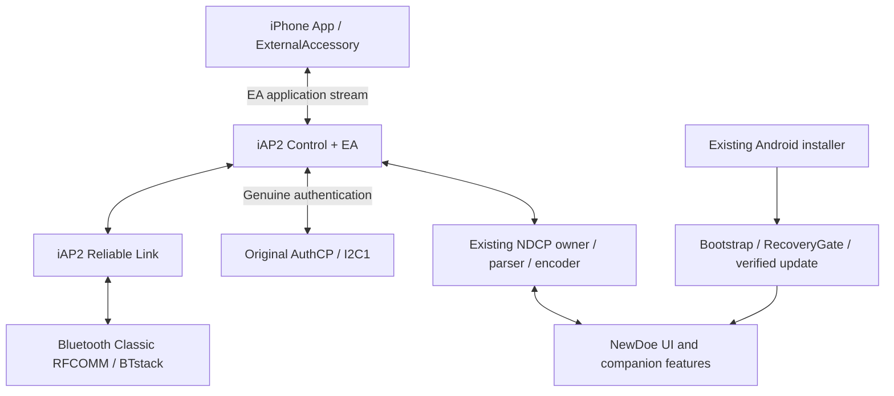

# NewDoe CFW — iOS / iAP2 整合研究總報告

**Independent technical research / 독립 기술 조사**  
**彙整版本：v93（涵蓋可取得的 v01–v92 研究紀錄）｜2026-11-25**  
Upstream: [SerialSniffyHeck3r/noodoe_cfw](https://github.com/SerialSniffyHeck3r/noodoe_cfw)

[繁體中文技術報告](#zh) · [English maintainer brief](#en) · [한국어 개발자 요약](#ko) · [研究檔案索引](#index) · [參考資料](#refs)

> [!IMPORTANT]
> 本文件為獨立、AI 輔助的技術研究彙整，不是官方 Apple iAP2 規格、NewDoe 官方發行版或可刷入韌體。現有候選程式通過離線測試，但 **尚未證實 NewDoe 能被 iPhone 發現、完成 MFi 認證或透過 EA 交換 NDCP 資料**。原廠 Noodoe 的 EA 串流曾開啟，不代表 NewDoe 已相容。未確認的設定不得當成正式產品參數；保留原有安裝、授權、驗證和回復機制。

<a id="zh"></a>
## 1. 專案目的與範圍

本研究的目標不是另做一套 Noodoe 韌體或診斷儀表，而是將 **iAP2 整合至現有 NewDoe Product CFW**，使自製 iOS App 可以使用現有 NDCP 的時間同步、GPS、音樂、通知和其他已實作的日常功能。沿用原作者 `noodoe_cfw` 的既有 Android 安裝器、Bootstrap、RecoveryGate、資源管理及回復機制。優先接受純 iAP2 日常通訊版本；原本 Android SPP 是否能完全移除，必須另驗證安裝後確認與維護流程，不能將日常通訊與安裝通道混為一談。

原作者公開倉庫提供研究文件、操作手冊及發行包，README 說明 Product 原始碼位於另一個私有倉庫。目前未取得完整 C/H、實際 BTstack/HAL 版本、Linker Script 或 Product MAP。先前已研究原始碼整合及二進位修改兩條路線，並未完成任一路線的實機部署。

### 證據分類

| 標記 | 意義 |
|---|---|
| **[DEVICE]** | 使用者報告的實際設備觀察，尚未必有可重播的 HCI/邏輯分析儀記錄 |
| **[STATIC]** | 固定版本原始映像、APK/IPA 或原作者文件之靜態分析；函式名稱為推定 |
| **[HOST]** | 電腦端測試、模擬 HAL/BTstack/peer、有限 ARM 指令模型 |
| **[ARM]** | Cortex-M4 Object 或分析 ELF 的編譯／連結結果，非 Product 最終容量 |
| **[OPEN]** | 未驗證、仍缺正式規格、實機資料或真實接口 |

本文的數值主要引用當時各版本的研究記錄，並非本次全部重新執行。原始碼版本、測試設定及實體硬體狀態不可互相替代。

## 2. iOS、IPA、iAP 與 iAP2 不同之處

| 名稱 | 角色 |
|---|---|
| iOS | iPhone 作業系統 |
| IPA (`.ipa`) | iOS App 封裝檔，可供靜態檢查 `Info.plist`；不是藍牙通訊協議 |
| iAP / iAP1 | Apple 早期配件通訊協議 |
| iAP2 | Apple 配件 Link、控制及 Session 協議；本專案的目標 |
| MFi / AuthCP | 配件授權及真正硬體認證相關機制 |
| ExternalAccessory / EA | iOS App 使用配件自訂協議的公開框架 |
| SPP | Bluetooth Classic Serial Port Profile，NewDoe 現有 Android 資料管道 |
| BLE / GATT | 另一套 BLE 資料通訊方式，不是 iAP2 的同義詞 |
| ANCS | Apple Notification Center Service，不等於 EA，也不證明 iAP2 可用 |
| NDCP | NewDoe 自身應用層封包格式 |
| Sunray | 原廠 Noodoe 應用層協議，與 NDCP 不同 |

本研究曾比較 BLE 路線，但目前以 iAP2 為主。不能把一般 Android SPP socket 直接搬到 iOS 的公開 API；EA 亦不是直接操作 RFCOMM 的任意 socket。[R1–R4]

## 3. 現有實機觀察及故障定位

| 設備／韌體 | 實際觀察 | 結論 |
|---|---|---|
| 原廠 Noodoe + iPhone | [DEVICE] EA 列出 `Bluetooth Display Board`，協議字串 `sunray.data` / `sunray.control`；曾開啟 EASession 串流，但 RX/TX 計數均為 0 | 原廠 EA 路徑存在；未證實應用資料交換 |
| NewDoe 1.0.1.0 + Android | [DEVICE] 可搜尋及配對 | Classic SPP 路徑可用 |
| NewDoe 1.0.1.0 + iPhone | [DEVICE] 藍牙設定及原廠 App 未找到設備 | 尚未建立可用 iAP2／EA 路徑 |
| nRF Connect | [DEVICE] 未找到相關 BLE 廣播，原廠也曾無法被掃到 | 不可單以 BLE 掃描結果推論 Classic Bluetooth 不運作 |
| 桌上儀表測試 | [DEVICE] 以 12 V ATX 供電曾完成 24 小時持續通電 | 有測試平台；不是 iAP2 穩定性證明 |

原廠韌體曾出現 `Noodoe ANCS` 相關線索。CFW 靜態分析找到 HCI、L2CAP、RFCOMM、SDP、CC256x 相關程式，未確認 ATT/GATT/SM 的完整實作。控制器能力、韌體是否啟用、手機 API 可見性是不同問題。不可宣稱所有 Noodoe 硬體都沒有 BLE。

### 目標通訊架構



圖為預定整合架構，並非已運作的系統。安裝器路徑不等於 Product 日常資料路徑。

## 4. 研究基準與原始映像

- 發行包：`NewDoe-CFW-1.0.1.0.zip`；研究版本固定於該包。
- `stock.bin`：458,752 bytes；分析基址 `0x08010000`；原廠 SR0701 stock 5.16。
- `cfw.bin`：458,752 bytes；前 64 KiB Gate、後 384 KiB Product。
- `diagnostic.bin`：393,216 bytes；獨立診斷映像，不等於 Product。
- 原廠使用 Bluetopia 相關路徑，NewDoe 使用 BTstack；不可直接移植原廠函式位址、連線 context 或識別模板。

| 映像 | SHA-256 |
|---|---|
| stock.bin | `162faeecc64bf56d828570168785e66d1a7da0152ef912bf83f9a19094d91edf` |
| cfw.bin | `2523b2e94a0df528486751ebf8acb57431f39fc8ff1ce46b13b992a6dd625d7a` |
| diagnostic.bin | `326bae70cfdf2f2c4f2a22f2efa9cbbb1dc1cdc40b7510ac20a6e96aaaaa35ec` |

[STATIC] 原始研究以 ELF wrapper 包裝 Thumb 指令，重新擷取 `.text` 與原始映像逐位元組比較；位址僅對上述 SHA 對應版本有效。資料區誤解譯成指令及未解析間接跳轉均為限制。

## 5. Discovery：EIR、SDP、RFCOMM

### 原廠與 CFW 差異

| 項目 | 原廠研究 | NewDoe CFW |
|---|---|---|
| Bluetooth stack | Bluetopia | BTstack |
| EIR / iAP 識別 | 找到 iAP 相關 UUID、名稱、HCI EIR 寫入線索 | 尚未驗證有完整 iAP 服務宣告 |
| SDP | 動態建立 iAP 相關記錄 | SPP UUID `0x1101`，名稱 `NewDoe SPP` |
| RFCOMM | 原廠 iAP service path | Channel 1，現有服務設定 512 B |
| MFi I2C1 | 原廠有使用路徑 | 作者文件指出 CFW 未接入 |

[STATIC] 早期研究找到原廠公開服務識別 UUID `00000000-DECA-FADE-DECA-DEAFDECACAFF`，以及 `0x1000`、`0x1101`、`0x1200`、名稱格式 `KYMCO Noodoe %s`、HCI opcode `0x0C52` 的線索。這些是辨識研究，不是可直接套用的 NewDoe 正式服務記錄。EIR 只是 discovery 的一部分；能看到設備不代表 SDP、配對、Link 或 MFi 成功。原廠 live SDP response 尚未完整擷取。

候選設計先前支援雙服務，v83 後選擇單服務模式，重用原有 Channel 1 與 SDP Handle `0x10001`。這是本地配置選擇，不是 Apple 指派值。只允許合法且完整的配件 profile 啟用服務；沒有可用 backend 時不要宣告可提供 EA。

## 6. iAP2 Link 層

### 6.1 封包格式（靜態分析與候選 codec）

| Offset | 長度 | 欄位 |
|---|---:|---|
| 0–1 | 2 | `FF 5A` |
| 2–3 | 2 | BE16 整個 Link frame 長度 |
| 4 | 1 | Control flags |
| 5 | 1 | Sequence number |
| 6 | 1 | Acknowledgement number |
| 7 | 1 | Link Session ID |
| 8 | 1 | Header checksum |
| 9… | N | Payload（可空） |
| 最後 | 1（有 payload 時） | Payload checksum |

[STATIC/HOST] Header 為 9 B；無 payload 時候選 codec 以 9 B 封包表示。有 payload 時為 `10+N` B。兩段 checksum 皆為 8-bit 加總的二補數，使各自區段加總 modulo 256 為零；不使用 NDCP CRC32。v13 重建 Detect 為 `FF 55 02 00 EE 10`，不是實際 RF trace。Control flags 靜態確認 SYN `0x80`、ACK `0x40`、EAK `0x20`；其他 reset/特殊旗標仍需正式規格驗證。

### 6.2 SYN 參數

原廠 `0x080656A0` 建構長度 13、16 或 19 B 的 SYN payload；固定前 10 B 加一到三組 3 B Session 描述。以下為 v11 靜態解讀：

| Offset | 欄位 |
|---|---|
| 0 | Version（觀察為 1） |
| 1 | Max outstanding |
| 2–3 | Max receive packet length, BE16 |
| 4–5 | Retransmit timeout, BE16 |
| 6–7 | Cumulative ACK timeout, BE16 |
| 8 | Max retransmissions |
| 9 | Max cumulative ACKs |
| 10… | Session descriptors：ID/type/version |

實際會啟用哪些 Session、協商預設數值、計時單位與容許的交握重試仍需 trace。原廠協商 `0x0806F188` 會更新部分 peer 參數，不一致重試計數與資料重傳次數不同。早期 strict-echo SYN fixture 不可當作 iPhone 真實行為。

### 6.3 Sequence、ACK、EAK、Backpressure

| 證據 | 解讀 |
|---|---|
| stock `0x0806E6A8` | 真正 iAP2 發送分支，含部分寫入與窗口限制 |
| stock `0x0806EFB0` | 另一 legacy sender；不要混稱為 iAP2 sender |
| stock `0x0806EDEA` | 8-bit RX sequence 比較與遞增 |
| stock `0x0806F0B4` | ACK／EAK 佇列處理 |
| stock `0x08071E54` | 排程與重傳計時器 |
| stock `0x0806F24C` 附近 | EA RX 與有條件延後 ACK 的證據 |

候選 Link 使用 8-bit modulo 序列號、4 個可靠 TX slot、512 B 本地 Link frame 上限；Control 訊息仍可組裝至 2048 B。這些均是候選實作的資源限制，不是 iAP2 通用上限。EAK 候選保留選擇性已確認的 slot，直到 cumulative ACK 回收；尚未證明完整 out-of-order buffer 或 fast retransmit。RFCOMM credit 表示底層流量資源，Link ACK 與 NDCP response 各有不同責任，不可混用。延後 RX 交付時必須保留資料與 generation，避免在應用層接受前誤判已處理。

## 7. iAP2 Control 與 MFi 認證

### 7.1 Control framing

[STATIC/HOST] 原廠 `0x0806C5AC` 解析 Control，候選 codec 使用 `40 40 | BE16 total length | BE16 message ID | parameters`。每個 parameter 使用 BE16 長度及 ID 再接資料。這是此研究的 framing 模型；完整正式 TLV 語意與欄位須由授權規格確認。

| Message ID | 候選語意 | 證據狀態 |
|---|---|---|
| `AA00 / AA01` | 認證憑證請求／回覆 | 原廠控制路徑、模擬 AuthCP |
| `AA02 / AA03` | 挑戰／簽章回覆 | 同上 |
| `AA04` | 對端認證失敗 | 原廠通知狀態 3，推定 |
| `AA05` | 對端認證成功 | 原廠通知狀態 0，推定 |
| `1D00 / 1D01 / 1D02` | 開始識別／資料／接受 | 原廠分支支持 |
| `1D03 / 1D05` | 其他識別結果或控制 | 部分語意未確認；候選採保守拒絕 |
| `EA00 / EA01` | EA Session 建立／結束 | 原廠分支支持；TLV tags 待確認 |

### 7.2 原廠硬體認證晶片

| 項目 | 研究結果 |
|---|---|
| 使用者讀取晶片絲印 | [DEVICE] `553 / 3959 / 1927` |
| 推定零件 | `337S3959` / AuthCP 2.0C 候選，仍需 read-only 探測 |
| I2C peripheral | [STATIC] I2C1，`0x40005400` |
| 接腳 | PB6/PB7，AF4 open-drain 候選 |
| 匯流排速度 | 100 kHz |
| 七位元地址 | `0x11` 候選；v69 probe 支援 `0x10/0x11` 的研究配置 |
| Reset | PH13 候選，未確認，不可直接操作 |
| 原廠 I2C init | `0x080413F2`；handle 線索 `0x200225EC` |

v69–v73 實作 read-only chip/version 探測、HAL I2C 鎖定與交易、憑證分頁讀取、晶片挑戰及回覆的候選狀態機。原廠分析顯示憑證分段最多 128 B；挑戰資料在所分析函式內直接交給晶片，未觀察到額外 SHA-1。Apple 公開 HomeKitADK 的上層認證與 iAP2 不完全相同，不能把 HomeKit 的處理步驟直接套入。[R5–R6]

v72 使用 `HAL_I2C_Mem_Read/Write`，真實晶片是否要求不同 STOP/repeated START、clock stretching、reset 或 power sequence 尚未以邏輯分析儀確認。v73 固定 1,290 B 回覆緩衝區、候選 20 B challenge 與 128 B 簽章長度；僅代表此候選晶片實作，未在實體板驗證。實際驅動必須使用真正受授權的晶片和板級恢復程序；不提供金鑰、憑證內容、身份複製、認證替代或重播。

### 7.3 認證生命週期

```text
LINK_READY
  -> certificate request/reply
  -> challenge/reply (genuine AuthCP)
  -> WAIT_PEER
  -> PEER_ACCEPTED
  -> IDENTIFICATION
  -> EA_READY (only with authorized profile and session)
```

v74 修正原本所有 Auth messages 都需 reply 的錯誤；AA05 是候選對端結果通知，不觸發新硬體請求。只在當前 generation、前置回覆完成後處理，失敗或逾時清除狀態；本地晶片完成不等於 iPhone 接受。候選採嚴格 ACK 順序與 5 秒 local timeout，非 Apple 正式要求，可能拒絕合法 peer 順序，必須實機驗證。

原廠分析錨點：憑證 `0x0806C6A0/0x0806C71C`；挑戰 `0x08065BFA`；結果通知 `0x0806C790`、`0x080657C0`。詳見 v73、v74 證據檔。

## 8. Identification 及 EA Session

### 8.1 識別

[STATIC] stock `0x0806C796` 處理 `1D00`，`0x0806C7BE` 組裝 `1D01`，`0x0806C7A0` / `0x0806C7B8` 對 `1D02` 更新狀態。原廠存在預先配置識別資料和附加欄位；舊 IPA `Info.plist` 與原廠 EA 觀察均指向 `sunray.data`、`sunray.control`。此處僅記錄觀察，並不將原廠身份資料當成 NewDoe 的正式 profile。

v75 實作 `nd75_configure()`、`nd75_identified()`，共用 Control Worker 2048 B buffer；識別資料必須由授權方提供且生命週期內不可改動。`IdentificationAccepted` 不自動授予 EA 權限。

### 8.2 三種 ID 不可混用

| ID | 用途 |
|---|---|
| RFCOMM CID | BTstack 動態連線識別，不等於 server channel |
| Link Session ID | 8-bit Link header 欄位，用於 demux |
| EA Protocol index | 配件已宣告的應用協議索引，正式值待配置 |
| EA Session ID | 動態 16-bit BE，EA payload 內部的識別 |
| NDCP sequence | 32-bit LE request/reply 匹配，與 Link sequence 不同 |

[STATIC] 原廠 `0x0806C88A` → `0x080658F0` 支持 EA 開啟；`0x0806C876` → `0x080659C8` 支持關閉。`0x0806E774` 寫入 BE16 EA session prefix，`0x0806F252–0x0806F276` 解析並跳過 2 B。完整 TLV tags、EA status response、允許的額外參數及 reopen 行為仍待確認。

```text
EA Link frame:
[9 B Link header][2 B EA session ID, BE][N B NDCP stream][1 B payload checksum]
```

對有資料的 EA frame，封裝開銷 12 B；候選 512 B Link MTU 下單次最多 500 B NDCP bytes。1044 B NDCP 封包可跨多個 Link frame，不能假設一個 RFCOMM read 就是一個 NDCP message。

v76 採單一 EA Session，EA01 時連同實體 RFCOMM 關閉，是簡化設計而非協議必然要求。模擬測試用 `0x1234` 動態 Session、合成 protocol index 和 tags，均非正式分配。

## 9. 原廠 Sunray 與 NewDoe NDCP

### 9.1 Sunray（v23–v24）

原廠應用資料有 `A5 5A` 內層封包；SPP 路徑另有 `5A FF` 外層，EA path 與 SPP 的 framing 不完全相同。靜態分析找到 Sunray command 分派、ready-like bootstrap 及 Ring Buffer full/empty 邊界問題。未取得完整 live Sunray handshake，也未證實原廠 EA 與 Android app payload 完全相同。NewDoe iOS App 不應照搬 Sunray 或向尚未確認的原廠命令發送資料。

### 9.2 NDCP v1（原作者文件與 v26 靜態驗證一致）

| Offset | 長度 | 欄位 |
|---|---:|---|
| 0–3 | 4 | ASCII `NDCP` (`4E 44 43 50`) |
| 4 | 1 | Version = 1 |
| 5 | 1 | Opcode |
| 6–7 | 2 | LE16 flags：response=1、error=2 |
| 8–11 | 4 | LE32 sequence |
| 12–13 | 2 | LE16 payload length |
| 14–15 | 2 | Reserved = 0 |
| 16… | N | Payload，最多 1024 B |
| 最後 | 4 | LE32 CRC32/ISO-HDLC（IEEE reflected） |

CRC32 覆蓋 Header + Payload，不含 CRC trailer；反射 polynomial `0xEDB88320`，initial `0xFFFFFFFF`，最後取補數。總長 `20+N`，最多 1044 B。回覆 payload 第一個 LE32 為 result，error flag 與非零 result 必須一致。原有協議採單筆同步 request/response，不能因逾時盲目重送寫入命令。[R7]

唯讀 HELLO 合成測試向量（seq=1）：

```hex
4E 44 43 50 01 01 00 00 01 00 00 00 00 00 00 00 70 23 13 00
```

此向量是候選 codec 測試用途，非 iPhone 實機封包擷取。第一個實機 EA 測試只應先核對合法配件及 Product 的 HELLO 合約，再進行唯讀往返。原有 1.0.1.0 靜態分析找到 `0x0807360C` parser、`0x0807384C` encoder、`0x0803B9DC` CRC wrapper；parser 可接受碎片與合併資料，payload 借用生命週期至 callback return。

### 9.3 App 功能研究狀態

| 功能 | 狀態 |
|---|---|
| HELLO `0x01` | 上游文件確認唯讀命令；候選空 payload 測試 |
| Capabilities `0x0D` | 上游文件及靜態分析支持；實際版本 bitmask 待核對 |
| Hello / poll / epoch | 早期 APK 靜態分析曾建立規則，尚未 live traffic 驗證 |
| 時鐘設定 `0x9F` | 早期 APK 分析曾報告 payload；此次未找到原始 Swift/Python 或完整欄位紀錄，暫不重建 |
| 手機 GPS `0x09` | 同上，待取得原始測試向量或合法實機 trace |
| 音樂、通知、圖片、導航 | 上游有不同版本的功能／capability 文件；未逐項完成 iOS 實機測試 |
| 安裝／維護 opcode | 保留在原有 Android installer 權限模型；不自動開放至 iOS 日常 App |

早期 Python reference、Swift package 和 golden vectors 曾回報彼此一致，未取得這些原始檔供此次完整複核；因此不宣稱已提供完整 iOS SDK 或全部 opcode payload。

## 10. iOS App / ExternalAccessory 整合

iOS App 使用 Apple 公開 `EAAccessoryManager`、`EAAccessory.protocolStrings`、`EASession` 及 input/output streams。[R1–R3] 先核對實際 accessory 和已核准 protocol，再建立 Session。`UISupportedExternalAccessoryProtocols` 需在 App `Info.plist` 宣告相同正式字串；`newdoe.data` 只是早期建議名稱，未獲授權或指派。IPA 的簽章／安裝方式與 iAP2 連線是不同問題。

建議 App 分層：

```text
EAAccessoryManager / EASession
    -> stream lifecycle + run loop + partial read/write
    -> NDCP incremental parser / encoder + CRC32
    -> request-response matching / timeout / connection epoch
    -> capability negotiation
    -> clock / GPS / music / notification features
```

Input/output stream open 不代表設備已送資料、也不代表 NDCP ready。斷線時清除 parser、取消 pending requests；等候新的 accessory/session 與 epoch。App 不負責自行模擬 MFi 認證或 raw iAP2 handshake，這由合法配件端與 iOS 系統完成。不要使用任意他人產品識別、私有 entitlement 或認證資料。

MFi FAQ 明確指出配件製造商決定允許通訊的第三方 App。正式產品的 iAP2、認證晶片、Product Plan、App 核准及配件 protocol 必須由授權方確認；擁有原廠晶片不代表改版自動獲得核准。[R4] v77/v80 僅完成 profile validator 及授權交接模板，未取得正式授權。

## 11. NewDoe Product 整合與原有 API 邊界

### 11.1 版本固定的 CFW 定位表

下表供作者將候選實作對照自己的原始工程，**不是可直接呼叫的 ABI**。原始 CFW 並無完整符號表，位址及功能名稱來自 v26、v53–v62、v78、v89–v90 的分析。

| 1.0.1.0 CFW 位址 | 推定功能或定位依據 |
|---|---|
| `0x08049396 / 0x080493A6 / 0x080493C6` | RFCOMM Service / Channel / SDP Record pool 初始化 |
| `0x080495E2–0x0804978C` | 原有 SPP SDP 建構區段 |
| `0x08049910` | 原有 Bluetooth callback，包含 data 與 event 處理 |
| `0x080464B0` | RFCOMM CID 查詢，現有路徑回傳 0 或 -1 |
| `0x08049E4E / 0x08049F38` | Incoming / Opened 事件處理定位 |
| `0x0804A00C` | Product CAN_SEND_NOW 處理；事件碼研究為 `0x89` |
| `0x0805AB04` | RFCOMM data callback 分派 |
| `0x080592FA–0x08059300` | 關閉與資源回收定位；實際 release fence 仍待查證 |
| `0x08020FFC / 0x0802103A` | NDCP TX enqueue / wake 定位 |
| `0x08021074 / 0x08021102` | NDCP RX read / parser 定位 |
| `0x080737C8` | Application reset 邊界線索 |
| `0x2000160C / 0x20001E0C` | 原有 RX/TX ring 候選基址，容量 2048/1024 B |

Product 目前僅一個 RFCOMM Service、SDP Record 和活動 Channel pool slot。雙服務版本曾需擴充 pool；純 iAP2 版本改為替換既有 SPP 服務，而不是新增第二個服務。實際是否移除 SPP 與何時轉換必須由整合端確認，v85 候選並未從真正 CFW 中刪除 SPP。

### 11.2 候選原始碼的模組及接線方式

| 檔案／版本 | 主要責任 |
|---|---|
| `iap2_codec.c`, `iap2_lab.c`, `iap2_reliable.c`, `iap2_duplex.c` | framing、交握、序列號、TX queue、重傳 |
| `iap2_control_v45.c`, `iap2_router_v46.c`, `nd_control_worker_v47.c` | Control 解析及路由，訊息組裝 |
| `nd_auth_v50.c`, `nd_mfi_port_v70.c` | 認證 request/poll/finish、generation、peer result |
| `nd_mfi_probe_v69.c`, `board/nd3959_hal_v72.c`, `board/nd3959_auth_v73.c` | 晶片辨識、I2C driver、實體 AuthCP 交易候選 |
| `nd_service_v63.c`, `nd_product_v62.c` | SDP/RFCOMM service 管理、Product transport adapter |
| `nd_ea_v65.c`, `nd_ea_v76.c` | EA ownership、Session 封裝及 NDCP bridge |
| `nd_product_v78.c`, `ports/nd_btstack_v79.c` | 統一 Product 接入、官方 BTstack API 綁定候選 |
| `tools/profile_v77.py`, `authorization/` | 正式配件設定一致性檢查及授權資料模板 |
| `cmake/ProductIntegration_v86.cmake`, `tools/preflight_v87.py` | 原始工程建置整合與唯讀映像檢查 |

v78 的統一入口包含 `nd78_init/start/stop/incoming/opened/rx/can_send/tick/closed/released`。由 Product 的唯一 serialized owner 提供合法 transport、service、NDCP、AuthCP、permit、drained callbacks，且須使用真正的 BTstack/HAL 版本。不可以 mock 取代實際授權或硬體結果。

BTstack 公開 API 包含 `rfcomm_register_service`、`rfcomm_accept_connection`、`rfcomm_decline_connection`、`rfcomm_request_can_send_now_event`、`rfcomm_can_send_packet_now`、`rfcomm_send`、`rfcomm_disconnect`、`sdp_register_service` 等。v79 針對 CAN_SEND_NOW 可能同步回呼而做延後交付，避免 request 尚未返回就進入傳送邏輯。實際 Product ABI、回呼格式與所有權仍需確認。[R8]

整合不變量：同一 generation / CID 的有效事件才可交付；真正的下層 pool、排程事件及 NDCP work 都回收後才釋放 owner；接收背壓不得遺失資料或提前 ACK；認證與識別及 EA 必須分開；所有 mock 後端只允許測試，不得被連入正式產品。

## 12. Flash、RAM 與最佳化結果

### 12.1 Product 記憶體

| 區域 | 位址／容量 | 條件 |
|---|---|---|
| Resident Bootloader | `0x08000000–0x0800FFFF`，64 KiB | 保留 |
| RecoveryGate | `0x08010000–0x0801FFFF`，64 KiB | 保留 |
| Product | `0x08020000–0x0807FFFF`，384 KiB | 原有 CFW + 新通訊功能 |
| 主 SRAM | `0x20000000–0x2002FFFF`，192 KiB | 保留實際 stack/heap/DMA 等 |
| Gate mailbox | `0x2002FF00–0x2002FFFF`，256 B | 不可清除或分配 |
| CCM RAM | 64 KiB | CPU 資料區，不作程式執行假設 |
| 外部 SDRAM | 64 MiB，`0xC0000000` 起 | 揮發性，實際 allocator 與 MPU 屬性待核對 |
| 外部 NOR | 128 MiB | 檔案式管理，不是直接 XIP 區域 |

原始 Product `.data` 1680 B、`.bss` 152112 B，靜態合計 153792 B；MSP 頂為 `0x2002FF00`。原始 SRAM 靜態資料後到 mailbox 的算術餘量 42560 B，不代表真實可分配 heap。

### 12.2 候選 ARM 連結測量（同一分析工具鏈）

| 版本 | 載入區段 B（-Oz + LTO） | 固定狀態 B | 主要變動 |
|---|---:|---:|---|
| v81 | 19,386 | 21,872 | 20 個候選 C 檔完整分析連結 |
| v82 | 19,272 | 18,800 | 兩份 Link Parser 2048 → 512 B |
| v83 | 19,310 | 18,800 | 單一 service；增加 SPP 拒絕檢查 |
| v84 | 19,232 | 16,872 | 事件佇列 8 → 1、NDCP wrappers 共用 |
| v85 | 18,796 | 16,860 | 純 iAP2、移除舊單 Session 測試路徑 |

v85 GCC / Clang ASan+UBSan 各 37/37 測試通過；其中包含 13 組純 iAP2 編譯配置。v84 單格事件佇列僅適用於經證實同步且不重入的 Product 路徑。512 B Link、4-slot window、2048 B Control message 均保留。

v81–v85 的分析 ELF 含故意不可執行的外部 API 占位符和分析根表；21 個直接外部符號（BTstack 10、HAL 5、ARM runtime 6）及多個真實 callback 仍需提供，不能把分析 ELF 轉成可用 Product。原有 Product 尾端 FF 只有 316 B，尚未證實可用。以簡單加總，v85 候選與原有映像間約有 18 KiB 容量差距；原有 SPP 尚未真正移除，所以最終 Flash 增量仍未知。

### 12.3 二進位實驗（v88–v92）

| 版本 | 實際研究成果 | 限制 |
|---|---|---|
| v88 | 原 SPP SDP 建構 426 → 132 B；294 B 候選重用空間；256 組指令模型測試 | 原 SPP 保留；無 iAP2 |
| v89 | 合併 4 個重複函式；淨增加 96 B；25,600 組模型比對 | 候選空間分散；非完整 CPU 驗證 |
| v90 | RX 路徑 126 → 100 B，保留共用出口；344 組模型測試；植入 148 B frame classifier | 無 live hook；2,021 組 host sanitizer 斷言；SPP 保留 |
| v91 | ARM 分析 ELF 的 SRAM/SDRAM 分區及壓縮實驗 | 無實際載入器；21 個占位函式仍在 |
| v92 | 原有資源 bank 與 SDRAM allocator 的唯讀稽核 | 無新增 hook、無配置實機空間、無修改原始映像 |

v90 植入前候選回收 416 B，植入 classifier 後剩 268 B，遠小於完整 v85 候選。所有 `cfw_OFFLINE_NOT_FLASHABLE*.dat` 僅用於離線研究；即使 Gate/vector 不變，亦不能視為安全刷入映像。未修改原始發行包，沒有更新 manifest 或發行新的 installer。

v91 的純算術配置：全部在主 SRAM 需 35692 B（剩 6868 B）；將 15180 B 大型狀態移至 SDRAM，主 SRAM 需 20496 B（剩 22064 B）。XZ 壓縮最佳為 13584 B，尚未計解壓程式。不得把算術餘量當成已配置空間，不應修改 MPU 或回復保護以強行載入。

v92 對 `resources.bin` 第一個 512 KiB Bank 的唯讀檢查：header 4096 B、payload 498364 B、32 records，尾端 FF 21828 B，4 KiB 對齊後算術餘量 20480 B。與 18796 B 候選比較剩 1684 B。第二個 Bank 有 A/B 管理責任，不是空白可用區。實際已證實可配置外部 NOR 空間仍為 **0 B**；須先確認資源驗證、版本切換、FAT 所有權、實際寫入／讀取範圍及維護流程。原有 allocator 的 32-byte 對齊、40-entry table、保留前 64 KiB 的證據僅支持研究假設，不是新的配置契約。

## 13. 原有 Installer 與最終發行格式

上游 `installer.md` 與 NDCP 維護合約清楚區分初次安裝與日常更新。[R7,R9]

- 初次安裝：Android wizard 透過原廠 APP 更新路徑部署 Bootstrap，檢查裝置／FAT／回復資料，使用既有程序安裝 64 KiB Gate + 384 KiB Product；需實際 reread/verify 和試啟動確認。
- 日常 Product 更新：384 KiB Product APP 送至 inactive NOR A/B 檔案，Gate 負責驗證與複製至內部 Flash。資源格式、Gate 或 Bootstrap 變更需獨立 migration 流程。
- 不變條件：原有 Bootloader、RecoveryGate、stock recovery、裝置身分、寫入授權、hash/CRC、readback、journal、trial confirmation 不得被省略。不能以藍牙連線或開機畫面代替永久確認。
- 純 iAP2 日常通訊需另解決 Android 安裝器在重啟後如何與 Product 完成相同 UID、候選版本、健康檢查及使用者確認。若尚未完成，保留原有維護路徑是必要設計選項。

| 1.0.1.0 發行檔 | 大小 B | 整合要求 |
|---|---:|---|
| `bootstrap.bin` | 457516 | 原樣保留 |
| `cfw.bin` | 458752 | 最終由已驗證 Product + 原 Gate 生成，尚未完成 |
| `stock.bin` | 458752 | 原樣保留 |
| `resources.bin` | 1048576 | 原樣保留，除非有正式資源 migration |
| `diagnostic.bin` | 393216 | 不作 Product 替代 |
| `uninstall.bin` | 458752 | 原樣保留 |
| `uninstall.legacy.bin` | 458752 | 原樣保留 |
| `wallpaper.bin` | 19094 | 原樣保留 |
| `manifest.properties` | 依版本 | 僅由真正發行流程更新，保留原有驗證 |

v86/v87 preflight 驗證器能檢查映像範圍、MSP、Thumb vector、ELF/BIN 一致、保留 mailbox 與 RecoveryGate，並拒絕分析 ELF。這些是必要條件而非部署保證。試啟動、回復、授權及整套實機功能都需另行通過。原有安裝器不是公開完整 Product source 的替代物。

## 14. 驗收次序與未完成事項

| 階段 | 驗收證據 | 目前 |
|---|---|---|
| A：原廠基準 | 同一台架，stock 的 discovery、pairing、EA stream、時間戳／非敏感 HCI 事件 | 部分使用者觀察，無完整 trace |
| B：CFW baseline | Android 原有 SPP HELLO／功能及回復，原始映像雜湊 | Android 配對觀察及靜態／host 證據 |
| C：合法服務 | 核准 profile、真實 BTstack service、iPhone discovery、RFCOMM open | 未完成 |
| D：Link | 真實 detect/SYN/ACK、fragmentation、backpressure、reconnect | 離線候選 |
| E：AuthCP | 確認晶片、電氣條件與合法交易，實際 iPhone accepted | 離線候選 |
| F：Identification | 真實核准 record 和 peer accepted | 離線候選 |
| G：EA | 合法 protocol、真實 EASession、雙向 session bytes | 未完成 |
| H：NDCP | 唯讀 HELLO，再 capabilities 與經確認的日常功能 | 未完成 |
| I：Product | 完整映像、實際 Flash/RAM/stack、原 UI 及功能測試 | 未完成 |
| J：Installer | 試啟動與確認、斷線、失敗及原有回復路徑 | 未完成 |

優先事項是取得**實際通訊與整合證據**，而非繼續增加候選模組數量。可以在不取得完整原始碼的情況下繼續唯讀分析原有接口、合法的台架 trace 和 iOS App codec，但沒有足夠已證實的二進位空間／ABI／執行環境時，不應將修改映像發行給使用者。建議由作者審核候選架構與真正 API，並提供最小合法整合接口或測試建置；不一定需要公開整個私有工程。

不要在行駛中的車輛測試。記錄 stage、時間、opcode、length、status、generation、失敗原因即可；不要將憑證、金鑰、私人通知、位置或實際裝置識別上傳至公開 GitHub。

<a id="en"></a>
## 15. English — Maintainer handoff

### Goal and current status

The objective is to integrate iAP2 into the **existing NewDoe Product CFW**, not to create an alternative instrument firmware or installer. The existing Android installer, Bootstrap, RecoveryGate, resource management, validation and stock recovery must remain intact. An iOS-only companion transport is acceptable, but removal of SPP must not break post-update confirmation or maintenance. A complete Product source tree is currently unavailable; both source-level candidates and offline binary experiments have been investigated.

The user's bench observations are encouraging but limited: stock Noodoe was visible to the iPhone as an EA accessory with `sunray.data` and `sunray.control`; EASession streams opened but RX/TX counters remained zero. NewDoe 1.0.1.0 could be paired with Android but was not discovered on the same iPhone. BLE scanner absence alone does not establish whether Classic Bluetooth is operating. There is no live NewDoe iAP2 handshake, MFi acceptance or NDCP exchange yet.

### Protocol and hardware findings

- Stock uses Bluetopia-related code; NewDoe uses BTstack with Classic SPP. Stock EIR/SDP and a version-specific iAP2-style receive path were identified. Reusing stock machine-code addresses, identity data or internal connection objects is not valid integration.
- Link framing: `FF 5A`, 9-byte header, BE length, 8-bit sequence/ACK/session, separate additive checksums. The reconstructed Detect is static evidence, not captured traffic. SYN uses ten fixed bytes plus three-byte session descriptors. Reliable TX windows, partial writes, cumulative ACK/EAK and delayed receive acknowledgement were studied; full peer negotiation and timing remain unverified.
- Control framing begins with `40 40`; AAxx authentication, 1Dxx identification and EAxx lifecycle branches were located. The original board appears to have a 337S3959/AuthCP 2.0C candidate on I2C1, PB6/PB7, 100 kHz, likely 7-bit address 0x11. The reported marking is 553/3959/1927; PH13 reset is not confirmed. The driver is a candidate using mock HAL tests only. Authentication must use the genuinely authorized hardware; local signature completion is distinct from actual peer acceptance.
- The 8-bit Link Session ID and 16-bit BE dynamic EA Session ID are different. An EA application payload carries the dynamic ID before the bytes. Formal parameter tags, supported protocol indices and identification fields require verified product configuration. NewDoe should carry NDCP, not copy the stock Sunray application protocol.
- NDCP is a 16-byte little-endian header, up to 1024 bytes of payload, and a four-byte IEEE CRC32 trailer. It supports incremental parsing of a byte stream. The reference HELLO vector is listed above. The earlier clock/GPS payload research could not be independently recovered in full for this consolidation. The iOS app should use ExternalAccessory streams, an incremental NDCP codec, sequence/epoch tracking and matching authorized protocol strings.

### Implementation and build status

The source package v85/v87 contains candidate Link, Control, AuthCP, Identification, EA bridge, service management and unified `nd78` Product API plus `nd79` BTstack bindings. v85 passed 37 GCC tests and 37 Clang ASan/UBSan tests in host environments; the candidate ARM analysis link is 18,796 bytes plus 16,860 bytes of fixed state. These are not production link costs. Real BTstack/HAL headers, NDCP callbacks, a legitimate accessory profile and the final Product build remain missing. Analysis ELF files contain nonfunctional placeholders and must not be flashed.

The binary-only v88–v90 experiments compacted several original functions and placed a 148-byte standalone frame classifier without a runtime hook. They did not remove the original SPP service or install an operational iAP2 stack. v91/v92 assessed alternative memory placement and resource-bank padding; the latter has 20,480 bytes of arithmetic aligned margin, but **no verified allocatable external NOR space or working loader**. The original installation package remains unchanged. Please do not interpret these experiments as a release candidate.

### What would help next

A maintainer review of the actual Product transport/worker contracts, BTstack version and allocation model, the real I2C transaction shape and supported profile would greatly reduce risk. A small authorized test build or documented integration interface could be sufficient; publishing the full private source tree is not requested as a prerequisite for collaboration. On the existing bench, validate discovery and RFCOMM first, then Link, genuine AuthCP acceptance, Identification, EA open and a read-only NDCP HELLO. Validate existing installer confirmation and recovery separately. No credential extraction, impersonation or authentication substitution is part of the proposed design. All product and app authorization must be obtained from the appropriate MFi licensee.

Thank you for the existing NewDoe work. This is an independent research contribution for review, not a replacement for the upstream project. The technical tables in the Chinese section contain version-pinned addresses, formats, measurements and source provenance.

<a id="ko"></a>
## 16. 한국어 — 개발자 전달 요약

### 목표 및 실제 상태

이 연구의 목표는 별도의 계기판 펌웨어나 설치 프로그램을 만드는 것이 아니라 **기존 NewDoe Product CFW에 iAP2를 통합하여 iPhone에서 NDCP 기반 기능을 사용할 수 있게 하는 것**입니다. 기존 Android 설치 프로그램, Bootstrap, RecoveryGate, 자원 관리, 검증 및 순정 복구 기능은 유지해야 합니다. 일상 연결을 iOS 전용으로 구성하는 것은 가능하지만, SPP 제거가 설치 후 시험 부팅 확인과 유지보수에 미치는 영향을 별도로 검증해야 합니다.

사용자가 보고한 실제 시험에서 순정 Noodoe는 iPhone의 ExternalAccessory에 `sunray.data`, `sunray.control` 프로토콜로 나타났고 EASession 스트림도 열렸으나 RX/TX는 모두 0이었습니다. NewDoe 1.0.1.0은 Android에서 검색 및 페어링이 가능했지만 같은 iPhone에서는 찾을 수 없었습니다. BLE 스캔 결과만으로 Classic Bluetooth 상태를 판단할 수 없습니다. 아직 NewDoe의 실제 iAP2 링크, MFi 인증 성공 및 EA/NDCP 왕복 통신은 입증되지 않았습니다.

### 기술 조사 결과

- 순정 펌웨어는 Bluetopia 계열 코드, NewDoe는 BTstack Classic SPP 경로를 사용합니다. 순정 EIR/SDP와 iAP2 형태의 수신 경로를 확인했지만 순정 함수 주소, 식별 데이터 또는 내부 객체를 NewDoe에 그대로 사용할 수 없습니다.
- Link 프레이밍은 `FF 5A`, 9바이트 헤더, BE 길이, 8비트 sequence/ACK/session 및 별도의 가산 체크섬으로 구성되는 후보입니다. Detect 및 SYN 분석은 정적 증거이며 실제 iPhone 캡처가 아닙니다. 송신 윈도우, 부분 쓰기, ACK/EAK 및 지연 ACK 경로를 조사했습니다.
- `40 40` Control 메시지와 AAxx 인증, 1Dxx 식별, EAxx 세션 분기를 확인했습니다. 기존 칩은 337S3959/AuthCP 2.0C로 추정되며 I2C1, PB6/PB7, 100 kHz, 7비트 주소 0x11 후보가 있습니다. 칩 마킹은 553/3959/1927로 보고되었으며 PH13 reset은 미확인입니다. 실제 칩과 승인된 프로필을 사용해야 하며, HAL 모형 테스트는 실제 인증 성공을 의미하지 않습니다.
- Link Session ID(8비트), EA Protocol Index, 동적 EA Session ID(16비트 BE)는 서로 다릅니다. EA의 애플리케이션 데이터 앞에는 동적 ID가 존재합니다. 공식 TLV와 식별 정보는 승인된 제품 설정 및 실제 장치에서 검증해야 합니다.
- NDCP는 16바이트 LE 헤더, 최대 1024바이트 페이로드, 4바이트 IEEE CRC32를 사용합니다. 순정 Sunray 대신 기존 NewDoe NDCP를 재사용하는 방향입니다. iOS 앱은 ExternalAccessory 스트림과 일치하는 승인 프로토콜 선언, 증분 파서 및 sequence/epoch 관리를 사용해야 합니다. 초기 시계/GPS payload의 원본 파일은 이번 통합 과정에서 완전히 확보하지 못했습니다.

### 구현 및 용량 상태

v85/v87 소스 패키지에는 Link, Control, AuthCP, Identification, EA, Product API 및 BTstack 바인딩 후보가 있습니다. GCC와 Clang ASan/UBSan에서 각각 37/37 host 테스트를 통과했습니다. 분석용 ARM 링크의 로드 구간은 18,796 B이고 고정 상태는 16,860 B입니다. 실제 Product의 최종 용량은 아니며, 외부 함수 자리표시자와 미연결 콜백이 있습니다. 분석 ELF를 플래시하면 안 됩니다.

v88–v90은 기존 바이너리의 일부 코드를 축소하고 148 B 프레임 검사 함수를 오프라인 이미지에 배치한 실험입니다. 실제 호출 경로, 인증, SPP 제거는 완료되지 않았습니다. v91–v92의 SRAM/SDRAM 및 NOR 자원 뱅크 조사에서 정렬 후 20,480 B의 계산상 여유를 확인했으나, 실제 할당 가능 공간 및 실행 로더는 검증되지 않았습니다. 원래 설치 패키지는 변경하지 않았습니다. 현재 플래시 가능한 새 CFW가 없습니다.

### 협력 요청 및 다음 시험

전체 비공개 소스 공개를 요구하는 것이 아닙니다. 실제 Product의 BTstack 버전, 이벤트/NDCP owner 계약, I2C 트랜잭션 형태, 승인된 프로필 또는 작은 통합 테스트 빌드만으로도 도움이 됩니다. 같은 벤치에서 검색 및 RFCOMM, Link, 실제 AuthCP 승인, Identification, EA 개설, 읽기 전용 NDCP HELLO 순으로 검증하고, 기존 설치 후 확인 및 복구 절차도 별도로 확인해야 합니다. 제조사와 MFi 라이선스의 승인 범위는 유지하며 인증 우회, 복제 또는 대체는 사용하지 않습니다.

기존 NewDoe 개발에 감사드립니다. 이 문서는 검토를 위한 독립 연구이며 공식 릴리스가 아닙니다. 상세한 주소, 프로토콜 표, 측정값 및 근거는 위 중국어 기술 섹션에 정리되어 있습니다.

<a id="index"></a>
## 17. 研究檔案索引 / Research index / 연구 파일 목록

以下為既有研究包名稱及主要內部檔案，方便在 GitHub 將原始碼、證據與本文並列。這些是歷史檔名索引，並非本文附帶全部 ZIP；公開前需確認散布權利，勿上傳原廠完整映像、個資、認證內容或不可刷入實驗映像作為正式 release。

| 範圍 | 研究檔案／包 | 主題 |
|---|---|---|
| v01–v10 | `README(2).md`、`README(1).md`、早期 EIR/SDP/Control/Identification/EA 報告 | 靜態發現、Discovery/Transport 原型 |
| v11–v24 | `NewDoe_iAP2_Link_Negotiation_v11.md`、`NewDoe_iAP2_Sequence_Window_v21.md`、`NewDoe_iAP2_EAK_Credit_EA_v22.md`、`NewDoe_iAP2_Sunray_RX_Framing_v23.md`、`NewDoe_iAP2_Sunray_Bootstrap_v24.md` | Link、ACK/EAK、Sunray 區別 |
| v25–v34 | `NewDoe_iAP2_Alpha_v25.zip`、`NewDoe_CFW_SPP_NDCP_Integration_v26.md`、Discovery v28、CC256x v29、Memory v31、I2C v33、Flash v34 | Codec、原有 Product 架構、資源 |
| v35–v52 | `NewDoe_iAP2_Diagnostic_Lab_v52.zip` 及各前置版本 | 離線 Link/worker/control/auth 測試；非 Product |
| v53–v67 | Native Integration v53/v58–v67、`INTEGRATION_BOUNDARY_v59.csv`、`EVENT_MAP_v60.csv`、`PRODUCT_PORT_v62.md`、`PRODUCT_PORT_v63.md` | Product API 邊界、SDP pool、EA bridge |
| v68–v73 | MFi Research v68/v69、`PRODUCT_PORT_v70.md`、`STOCK_I2C_EVIDENCE_v72.txt`、`STOCK_AUTH_EVIDENCE_v73.txt` | 晶片探測、HAL、AuthCP 候選 |
| v74–v76 | `STOCK_PEER_EVIDENCE_v74.txt`、`STOCK_IDENT_EVIDENCE_v75.txt`、`STOCK_EA_EVIDENCE_v76.txt` | Peer outcome、Identification、EA |
| v77–v80 | `PRODUCT_PROFILE_v77.md`、`PRODUCT_PORT_v78.md`、`PRODUCT_PORT_v79.md`、`AUTHORIZATION_v80.md` | Profile、統一 API、BTstack、授權 |
| v81–v85 | `NewDoe_CFW_Native_Integration_v85.zip`、`LINK_RESULTS_v85.txt`、`TEST_GCC_v85.txt`、`TEST_SAN_v85.txt` | 容量、純 iAP2 候選、回歸測試 |
| v86–v87 | `NewDoe_CFW_Native_Integration_v87.zip`、`release/BUILD_READY_v86.md`、`release/STARTUP_LINK_v87.md`、`tools/preflight_v87.py` | 原安裝格式、啟動、驗證 |
| v88–v90 | `NewDoe_Binary_Patch_v88.zip` 至 v90 | 離線二進位縮減及未掛接 classifier |
| v91–v92 | `NewDoe_Binary_Patch_v91.zip`、`NewDoe_Binary_Patch_v92.zip`、`CAPACITY_v92.txt`、`RESOURCE_AUDIT_v92.json` | 分區、壓縮、資源 Bank 唯讀稽核 |

### 可重現的 host 候選測試（v85/v87）

從合法取得的 Native Integration 原始碼包解壓，於其根目錄執行（需 CMake 與支援 C 的編譯器）：

```sh
cmake -S . -B build
cmake --build build --config Release
ctest --test-dir build -C Release --output-on-failure
```

原始研究的 ARM 測量使用 Clang 17、Cortex-M4 Thumb、`-Oz -flto` 和分析 Linker 配置。它不是 Product 工程或真正 HAL/BTstack build。歷史測試結果位於各包 `TEST_*.txt`；本報告為資料彙整，本次未重新跑完整 C/ARM/硬體測試。

<a id="refs"></a>
## 18. Sources / 參考資料 / 참고 자료

公開資料的用處限於框架、上游合約及 API 說明；沒有將未公開 MFi 規格當作公開來源。

- **R1** Apple Developer, [External Accessory](https://developer.apple.com/documentation/externalaccessory/).
- **R2** Apple Developer, [EASession](https://developer.apple.com/documentation/externalaccessory/easession) and [EAAccessory](https://developer.apple.com/documentation/externalaccessory/eaaccessory).
- **R3** Apple Developer, [UISupportedExternalAccessoryProtocols](https://developer.apple.com/documentation/bundleresources/information-property-list/uisupportedexternalaccessoryprotocols).
- **R4** Apple, [MFi Program FAQ](https://mfi.apple.com/en/faqs.html) and [Verifying accessories for Apple devices and services](https://support.apple.com/guide/security/verifying-accessories-for-apple-devices-and-services-sec70a4f377d/web).
- **R5** Apple public HomeKitADK, [HAPMFiHWAuth.c](https://github.com/apple/HomeKitADK/blob/master/HAP/HAPMFiHWAuth.c). Cross-protocol hardware reference only, not an iAP2 specification.
- **R6** STMicroelectronics, [STM32F4 HAL I2C driver](https://github.com/STMicroelectronics/stm32f4xx-hal-driver/blob/master/Src/stm32f4xx_hal_i2c.c).
- **R7** NewDoe upstream, [NDCP protocol notes](https://github.com/SerialSniffyHeck3r/noodoe_cfw/blob/main/Projects/documentations/technical-notes/ndcp-protocol.md).
- **R8** BlueKitchen, [BTstack RFCOMM API](https://bluekitchen-gmbh.com/btstack/develop/appendix/rfcomm/) and [Protocol manual](https://bluekitchen-gmbh.com/btstack/protocols.html). The installed Product revision is not verified.
- **R9** NewDoe upstream, [Installer](https://github.com/SerialSniffyHeck3r/noodoe_cfw/blob/main/Projects/documentations/installer.md) and [Memory map](https://github.com/SerialSniffyHeck3r/noodoe_cfw/blob/main/Projects/documentations/memory-map.md).
- **R10** NewDoe upstream, [stock assembly](https://github.com/SerialSniffyHeck3r/noodoe_cfw/blob/main/Projects/documentations/stock-assembly.md); local repository snapshot hardware notes `Projects/documentations/research-notes/ak550-sr15-mcu-peripheral-settings.md` and `Projects/documentations/architecture.md`.
- **Primary research inputs:** user-supplied `NewDoe-CFW-1.0.1.0.zip`, `noodoe_cfw-main.zip`, earlier stock IPA/APK inspection notes, user-reported bench observations, and versioned research records in Section 17. Upstream NDCP and installer details were checked against the supplied repository snapshot; public Apple/BTstack documentation was checked for this consolidation. Links may subsequently change.

## 19. 最終結論 / Conclusion / 결론

**NewDoe + iAP2 是本研究的唯一主線。** 離線通訊候選、原廠證據與 Product 接入設計已有相當進展，現階段不能以任何 PASS 計數或二進位容量推算代替真實 iPhone 連線。最有價值的後續工作是合法配件設定、真實 transport/NDCP/HAL 整合、實際 trace 及原有安裝回復機制的端對端驗收。

**No operational iAP2-enabled NewDoe firmware is demonstrated yet.** The original installer remains the intended deployment path; preserve its verification and recovery.

**실제로 동작하는 iAP2 지원 NewDoe 펌웨어는 아직 입증되지 않았습니다.** 기존 설치 및 복구 절차를 유지하면서 실제 장치 검증을 진행해야 합니다.
