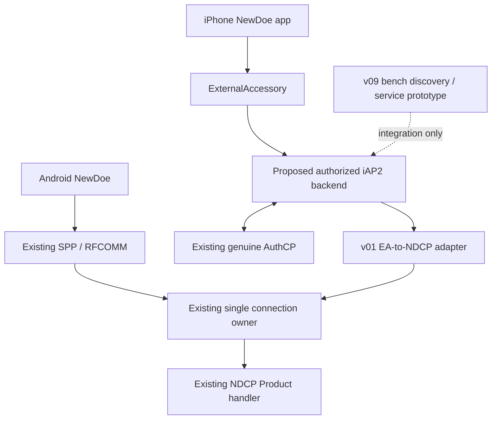

# NewDoe iAP2 Research — iOS Connectivity PoC

**Independent, AI-assisted research · 2026-11-24 · Research revision v10**

[한국어](#ko) | [繁體中文](#zh) | [English](#en) | [Technical evidence / 技術證據 / 기술 근거](#evidence) | [File index / 檔案索引 / 파일 목록](#files)

> [!IMPORTANT]
> **EN:** This is a research repository, not an official NewDoe release or flashable firmware. iPhone discovery, MFi authentication and end-to-end NewDoe iAP2 pairing have not been demonstrated.  
> **中:** 本倉庫是研究資料，不是官方 NewDoe 發行版，也沒有可刷寫韌體。尚未證實 iPhone 能搜尋 NewDoe、完成 MFi 認證或建立完整 iAP2 連線。  
> **한:** 이 저장소는 연구 자료이며 공식 NewDoe 릴리스 또는 플래시 가능한 펌웨어가 아닙니다. iPhone에서 NewDoe 검색, MFi 인증 및 종단 간 iAP2 페어링은 아직 실기기로 입증되지 않았습니다.

<a id="ko"></a>
## 한국어

### 1. 연구 목적 및 배경

이 연구는 [NewDoe CFW](https://github.com/SerialSniffyHeck3r/noodoe_cfw)의 iOS 연결을 지원하기 위한 독립적인 기술 조사입니다. 저는 대만의 Noodoe 사용자이며, 실제 계기판과 iPhone/Android 기기로 테스트할 수 있습니다. 임베디드 및 iOS 개발 지식은 기초 수준이고, 역분석과 프로토타입 작성에는 ChatGPT/Claude의 도움을 많이 받았습니다. 모든 추론은 개발자의 검토와 실기기 검증이 필요합니다. 기존 개발자의 작업을 대체하려는 것이 아니라 협력하고자 합니다.

최종 목표는 Android를 CFW 설치 및 유지보수에 계속 사용하면서, iPhone으로 시간 동기화, GPS, 음악, 알림 및 설정 등 일상 기능을 사용하는 것입니다. iOS에서 펌웨어 설치 기능을 구현하는 것은 현재 목표가 아닙니다. 추가 하드웨어 없이 기존 보드와 MFi 인증 칩을 적법하고 지원되는 방식으로 활용할 수 있는지 확인하고 싶습니다.

### 2. 문제와 현재 증거

사용자 실기기 관찰에서 순정 Noodoe는 iPhone ExternalAccessory로 인식되었고 `sunray.control`, `sunray.data`의 EASession 입출력 스트림이 열렸습니다. 다만 수신/송신 바이트는 0이었으므로 실제 응용 데이터 교환까지 확인한 것은 아닙니다. NewDoe 1.0.1.0은 Android에서 검색되었지만 동일 실험의 iPhone에서는 발견되지 않았습니다. 이는 일반 Classic SPP와 iOS용 EA 전송의 차이와 일치합니다. iOS에서 BLE GATT도 대안이 될 수 있으나 현재 NewDoe에 사용 가능한 GATT 서비스가 확인된 것은 아닙니다.

개발자는 보드의 MFi 칩을 발견하고 칩 식별 통신에 성공했다고 알려 주었습니다. 칩 식별 성공은 전체 iAP2 인증 성공과 다릅니다. 공개 저장소 ZIP에는 871개 파일이 있지만 C/H/C++ 소스가 없었습니다. 따라서 실제 Product 코드에 패치를 적용하거나 펌웨어 전체를 빌드하지 않았습니다.

### 3. 순정 펌웨어 역분석 결과 (v01–v08)

- **v01–v02, 검색:** 순정 `stock.bin`의 Apple accessory UUID와 EIR 생성 경로를 확인했습니다. 시작 시 압축된 RAM 초기화 데이터를 복원하여 4개의 EIR 기술자를 재현했습니다. 장치명은 런타임 버퍼이며 TX Power 포인터는 초기 상태에서 NULL입니다. NewDoe의 SPP 레코드는 확인되지만 동일 iAP UUID의 일반적인 바이트 배열은 발견되지 않았습니다. 이 부재만으로 기능이 없다고 단정하지 않습니다.
- **v03–v04, SDP/RFCOMM 및 이벤트:** 순정 iSPP 초기화, 동적으로 만들어지는 iAP 서비스 UUID, 원격 iPhone 서비스 UUID 조회 후보 및 이벤트 콜백을 찾았습니다. RFCOMM 채널 1은 후보이며 실측 SDP로 확인해야 합니다. 일반 데이터 경로와 두 개의 논리 세션 경로가 구분됩니다.
- **v05, 링크 계층:** `FF 55` 계열과 `FF 5A` 계열의 프레임 처리, 9바이트 iAP2형 헤더, Big Endian 길이, 8비트 보수 체크섬, SYN/ACK 후보 및 세션 분기가 확인되었습니다. 단순 상수 검색이 아니라 수신 함수와 파서의 호출 관계도 분석했습니다. 이는 이 순정 이미지의 iAP2 구현에 대한 강한 정적 근거이지만 iPhone이 실제 협상한 프로토콜 버전은 HCI 캡처로 확인해야 합니다.
- **v06, 제어 및 인증:** `40 40` 제어 메시지와 AAxx 인증, 1Dxx 식별, EAxx 세션 계열의 처리 경로가 발견되었습니다. I2C1에 연결된 실제 인증 칩을 사용하는 경로와 일치합니다. 공개 하드웨어 연구 노트의 I2C1/PB6/PB7, 100 kHz, 7비트 주소 `0x11`과도 일치합니다. PH13 리셋은 후보이며 확인 없이 토글하지 않습니다. 인증 알고리즘의 완전한 구현 또는 우회 방법은 제공하지 않습니다.
- **v07, 식별:** 복원된 RAM의 252바이트 식별 템플릿에서 장치명, 모델, 제조사 및 `sunray.data`(Protocol ID 1), `sunray.control`(ID 2)을 확인했습니다. 별도로 순정 iOS IPA의 Info.plist에서도 두 문자열을 확인했습니다. 원본 제품 식별자/인증 자료는 재사용할 템플릿으로 제공하지 않습니다.
- **v08, EA 세션:** 세션 생성/해제, 중복 처리 및 동적 ID에 따른 데이터 분배를 추적했습니다. Protocol ID, Link Session ID 및 EA Session ID는 서로 다른 식별자입니다. 이 결과는 iAP2가 응용 프로그램 바이트 스트림을 제공한다는 가설을 지지하지만 Android와 iOS의 Sunray 응용 페이로드가 동일하다는 증거는 아닙니다.

주소와 근거는 아래 공통 기술 표와 개별 보고서를 참조하십시오. 함수 이름은 추론한 이름이며 원본 디버그 심볼이 아닙니다. 순정 Bluetopia 함수 주소를 BTstack 기반 NewDoe에서 직접 호출할 수 없습니다.

### 4. 작성한 C 프로토타입

**Discovery v09:** 기존 EIR을 보존하면서 iAP 식별을 추가하는 C 모듈, 선택적 실험용 EIR-only 모드, SDP/RFCOMM 어댑터 및 mock 테스트를 포함합니다. 기본적으로 EIR-only 실험 모드는 비활성화되어 있습니다. 실제 backend가 없는 경우 일반 등록을 거부합니다. EIR-only 모드는 검색 필터를 확인하기 위한 벤치 실험일 뿐 SDP/EA/MFi 인증이나 페어링을 구현하지 않습니다. 이 모드를 제품에 배포하면 안 됩니다. 실제 BTstack revision, 기존 EIR 생성 방식, 채널 및 수명 주기는 개발자가 검토해야 합니다.

**Transport v01:** 실제 인증을 마친 EA 세션을 기존 NDCP에 연결하기 위한 후속 어댑터입니다. CRC32, 분할 수신/송신, 단일 연결 소유권, 세션 generation 및 오류 정리를 구현한 독립 C11 프로토타입입니다. 초기 실험은 빈 payload의 읽기 전용 HELLO `0x01`만 허용합니다. 실제 Product HELLO 계약은 개발자의 확인이 필요합니다. 다른 명령은 차단되며 `newdoe.data`는 제안된 이름일 뿐입니다. 이 모듈 자체로 iPhone 검색/페어링은 불가능합니다.

두 프로젝트의 `make test`를 원본 ZIP에서 다시 실행하여 모든 host 테스트가 통과했습니다. v09의 BTstack 테스트는 mock이며, 기존 결과의 438 bytes는 Cortex-M4 EIR core 객체의 text 크기일 뿐 전체 iAP2의 메모리 요구량이 아닙니다. v01 host 상태 구조체는 해당 빌드에서 2,168 bytes였습니다. 전체 STM32 Product 빌드, 실제 RF, 인증, 차량 운행 검증은 하지 않았습니다.

### 5. 제안하는 통합 및 검증 순서

1. 개발자와 pinned BTstack 버전/설정, GAP/EIR, SDP/RFCOMM 초기화, 연결 owner 및 AuthCP 인터페이스를 확인합니다. 순정 HCI의 cold boot부터 EA 연결까지 안전한 수동 캡처로 정적 분석을 검증합니다.
2. 별도 벤치 Product 빌드에서 v09의 제한된 검색 실험을 검토합니다. Android SPP 및 보안 설정을 유지하고 HCI EIR 적용 결과, iPhone EA picker와 SDP를 확인합니다. 검색 성공은 페어링 성공이 아닙니다. 실험 후 정상 빌드로 복원합니다.
3. 호환되고 정당하게 사용할 수 있는 iAP2 backend를 선정하고 Link, Control, 기존 AuthCP의 유효한 인증, 자체 승인된 identification 및 EA 세션을 통합합니다. BlueKitchen의 MFi/iAP2 지원도 문의할 수 있습니다. 인증 성공을 가정하거나 모의 성공으로 대체하지 않습니다.
4. 인증된 EA 세션에서 v01을 실제 NDCP owner와 연결합니다. 우선 HELLO를 확인하고 이후 권한이 정의된 일상 기능만 추가합니다. SPP와 동시 소유를 피하고 disconnect/reconnect, timeout, queue 및 stale epoch 처리를 확인합니다.
5. Flash/RAM/CCM, watchdog, 실제 RF, Android 호환성, 재부팅/복구를 검증합니다. Bootloader, RecoveryGate, 설치/복구 정책, NOR 파일 및 차량의 안전 관련 표시 기능은 변경하지 않는 것이 원칙입니다. 초기 실험은 주행 중 또는 실차에서 하지 않습니다.

### 6. 개발자에게 요청

현재 필요한 것은 전체 비공개 소스의 공개가 아닙니다. 가능하다면 Product의 Bluetooth 초기화, 기존 EIR builder, pinned BTstack config, SDP/RFCOMM callback 및 lifecycle, 실제 NDCP dispatch/response와 owner API, AuthCP 식별 드라이버 또는 검토 가능한 인터페이스, linker map을 공유하거나 직접 통합해 주시면 좋겠습니다. 승인된 iAP2 backend의 가용성도 함께 확인하고 싶습니다.

저는 iPhone과 Android, 벤치 계기판을 이용해 검색, 정상 인증, EA 스트림, NDCP 응답 및 재연결을 검증하고 민감한 정보를 제거한 로그를 제공할 수 있습니다. 아직 완료되지 않은 기능을 구현했다고 주장하지 않겠습니다. 개발자의 조언과 검토에 감사드립니다.

<a id="zh"></a>
## 繁體中文

### 1. 研究目的與背景

這是針對 [NewDoe CFW](https://github.com/SerialSniffyHeck3r/noodoe_cfw) 增加 iOS 通訊能力的獨立研究。我是台灣的 Noodoe 使用者，有實體儀表、iPhone 與 Android 可進行測試。我的嵌入式與 iOS 開發知識仍屬基礎，逆向及原型撰寫大量借助 ChatGPT／Claude。所有推論與程式皆需要作者審查及實機驗證；此研究以合作為目的，並非取代原開發者。

最終目標是保留 Android 安裝與維護 CFW 的能力，之後使用 iPhone 進行時間同步、GPS、音樂、通知、設定等日常功能。現階段不需要 iOS 刷寫韌體。希望在不增加硬體的前提下，以合規且受支援的方式利用現有主板與 MFi 晶片。

### 2. 問題與目前證據

使用者實測原廠 Noodoe 可被 iPhone ExternalAccessory 辨識，並開啟 `sunray.control` 與 `sunray.data` 的 EASession 輸入、輸出串流；但 RX/TX 都是 0，因此只證明串流已開啟，沒有證明應用資料已交換。NewDoe 1.0.1.0 可被 Android 搜尋，在同組實驗的 iPhone 上卻未被發現。這與一般 Classic SPP 和 iOS EA 傳輸能力不同的情況一致。BLE GATT 也是可能的替代方案，但目前尚未確認 NewDoe 有可用的 GATT 服務。

作者已告知找到主板 MFi 晶片，且可以讀取晶片識別資訊；讀取晶片不等於完整 iAP2 認證成功。公開 GitHub ZIP 有 871 個檔案，但沒有 C/H/C++ 原始碼，故目前未對真正的 Product CFW 套用修改，也未完成完整韌體編譯。

### 3. 原廠韌體逆向成果（v01–v08）

- **v01–v02，裝置探索：** 定位原廠 Apple 配件服務 UUID 與 EIR 建立路徑，還原開機時壓縮的 RAM 初始化資料及四筆 EIR 描述項目。名稱為執行時緩衝區，TX Power 指標初始為 NULL。NewDoe 可找到 SPP 紀錄，但未找到相同 iAP UUID 的常見排列；不以字串或位元組缺失直接斷定功能不存在。
- **v03–v04，SDP／RFCOMM 與事件：** 定位原廠 iSPP 初始化、動態建立 iAP UUID 的服務註冊、查詢遠端 iPhone 服務的候選路徑與事件 Callback。RFCOMM Channel 1 為候選值，尚需實際 SDP 確認。原廠具有一般資料路徑及兩個邏輯 Session 路徑。
- **v05，Link Layer：** 找到 `FF 55` 及 `FF 5A` 類型的封包處理、9-byte iAP2 型標頭、Big Endian 長度、8-bit 二補數校驗、SYN/ACK 候選及 Session 分流。除常數外，亦追蹤到接收函式通往解析器的呼叫關係。此為該原廠映像含有 iAP2 實作的強力靜態證據，但 iPhone 實際協商的版本仍須以 HCI 擷取確認。
- **v06，Control 與認證：** 找到 `40 40` 控制訊息與 AAxx 認證、1Dxx 識別、EAxx 工作階段系列的分流，並追蹤到 I2C1 實體認證晶片通訊路徑。與作者公開硬體筆記的 I2C1、PB6/PB7、100 kHz、7-bit `0x11` 相符；PH13 Reset 尚為候選，不應在未確認時任意切換。此研究未提供完整認證實作或繞過方式。
- **v07，Identification：** 從還原 RAM 中找到 252-byte 識別模板，含配件名、型號、製造商，以及 `sunray.data`（Protocol ID 1）、`sunray.control`（ID 2）。另獨立核對原廠 iOS IPA 的 Info.plist，確有相同兩個協定名稱。未提供可直接複製原廠產品識別或認證材料的模板。
- **v08，EA Session：** 追蹤開啟、關閉、重複 Session 管理及依動態 ID 進行資料分流的機制。Protocol ID、Link Session ID、EA Session ID 為不同概念。這些證據支持 iAP2 提供一般應用資料流的假設，但尚未證明 Android 與 iOS 的 Sunray 應用封包完全一致。

詳細位址請見下方共用技術表與各份報告。函式名稱皆為逆向推定而非正式除錯符號；不可直接在 BTstack 的 NewDoe 韌體呼叫原廠 Bluetopia 函式位址。

### 4. 已撰寫的 C 原型

**Discovery v09：** 包含保留原 EIR 資訊並增加 iAP 識別的 C 模組、可選的 EIR-only 實驗模式、SDP/RFCOMM 適配程式及 mock 測試。EIR-only 預設關閉，正常註冊在沒有 backend 時會拒絕。該模式僅供台架驗證裝置搜尋篩選，不實作 SDP／EA／MFi 認證或配對，不能部署至正式版。實際 BTstack 版本、EIR 來源、服務 Channel 及生命週期都需要原作者審查。

**Transport v01：** 用於將已完成真正認證的 EA Session 接入現有 NDCP，為配對後的獨立 C11 原型。實作 CRC32、分段收發、單一連線所有權、Session generation 及錯誤清理。首輪只允許空 payload 的唯讀 HELLO `0x01`，仍需作者確認 Product HELLO 真實參數；其他指令全部拒絕。`newdoe.data` 只是建議名稱。此模組本身不能使 iPhone 搜尋或配對 NewDoe。

重新從兩個原始 ZIP 解壓並執行 `make test`，本機測試全部通過。v09 的 BTstack 測試為 mock，既有測試報告中的 438 bytes 是 Cortex-M4 EIR 核心物件 text 大小，不是完整 iAP2 的容量；v01 host 狀態結構在該次編譯為 2,168 bytes。尚未執行完整 STM32 Product 編譯、真實 RF、實體 MFi 認證及實車驗證。

### 5. 建議整合與驗收順序

1. 與作者確認 BTstack 固定版本與配置、GAP/EIR、SDP/RFCOMM 初始化、連線 owner 與 AuthCP 介面。安全被動擷取原廠從冷開機至 EA 連線的 HCI 資料，驗證靜態推論。
2. 由作者在獨立台架 Product build 評估 v09 的搜尋實驗。保留 Android SPP 與安全設定，確認 EIR 實際寫入、iPhone EA 選擇器及 SDP。搜尋成功不等於配對成功；測完恢復正常韌體。
3. 選擇可合法使用且相容的 iAP2 backend，整合 Link、Control、現有 AuthCP 有效認證、自身合適的配件識別與 EA Session。可洽詢 BlueKitchen 的 MFi/iAP2 支援。不得假設認證成功或用模擬成功回覆取代真實認證。
4. 完成認證的 EA Session 再接 v01 與實際 NDCP owner，先驗證 HELLO，逐步加入有明確權限的日常功能。避免 SPP 與 iAP 同時佔用，驗證斷線、重連、timeout、queue、stale epoch。
5. 驗證 Flash/RAM/CCM、watchdog、真實 RF、Android 相容性、重開機與恢復。原則上保留 Bootloader、RecoveryGate、安裝／恢復政策、NOR 及安全相關儀表功能不變。初次實驗不要在行駛中或實車上進行。

### 6. 希望作者協助的部分

我們不需要作者公開整套私有原始碼。若可提供、審查或協助整合 Product Bluetooth 初始化、現有 EIR builder、BTstack 固定版本與 config、SDP/RFCOMM callback 與生命週期、實際 NDCP dispatch/response 與 owner API、AuthCP 晶片識別驅動或介面、linker map，便能更精確地推進。也希望一同確認可合法使用的 iAP2 backend。

我可以利用台架儀表、iPhone 與 Android 測試搜尋、有效認證、EA 串流、NDCP 回覆與重連，並提供移除敏感資訊後的紀錄。未完成的功能不會宣稱已實作。感謝原作者的開發、建議與審查。

<a id="en"></a>
## English

### 1. Goal and background

This is an independent investigation into adding iOS connectivity to [NewDoe CFW](https://github.com/SerialSniffyHeck3r/noodoe_cfw). I am a Noodoe user in Taiwan with a physical dashboard, an iPhone and an Android phone available for testing. My embedded and iOS development knowledge is basic; I rely heavily on ChatGPT and Claude for reverse engineering and prototype development. The findings and code need developer review and physical validation. This is intended as a collaboration, not a replacement for the original author's work.

The goal is to keep Android for CFW installation and maintenance while allowing everyday functions such as clock sync, GPS, music, notifications and settings from an iPhone. iOS firmware installation is not a current goal. I would like to evaluate whether the original hardware and its MFi chip can be used through a supported, authorized integration without adding hardware.

### 2. Problem and available evidence

In user-reported physical tests, stock Noodoe was visible through iPhone ExternalAccessory and EASession input/output streams opened for `sunray.control` and `sunray.data`. RX and TX were both zero, so opening a stream is not evidence of application data exchange. NewDoe 1.0.1.0 was discoverable on Android but not on the iPhone in the corresponding experiment. This is consistent with the distinction between ordinary Classic SPP and an iOS-compatible EA transport. BLE GATT is another possible approach, but no usable NewDoe GATT service has been demonstrated.

The developer reported finding the on-board MFi chip and communicating with it to identify it. Chip identification is not equivalent to complete iAP2 authentication. The supplied public GitHub ZIP contains 871 files but no C/H/C++ source files. Consequently, no patch has been applied to the real Product project, and no complete firmware build has been produced.

### 3. Stock firmware reverse engineering (v01–v08)

- **v01–v02, discovery:** Located the stock Apple accessory UUID and EIR construction path. Recovered the compressed startup RAM initialization data and reproduced four EIR descriptors. The name is a runtime buffer; the TX Power pointer is initially NULL. NewDoe contains an SPP record, but common byte representations of the same iAP UUID were not found. Absence alone is not proof of missing functionality.
- **v03–v04, SDP/RFCOMM and events:** Located stock iSPP initialization, dynamic iAP UUID construction, a candidate remote iPhone SDP query and event callbacks. RFCOMM channel 1 remains a candidate until confirmed by a live SDP response. The stock firmware distinguishes a generic data path and two logical session paths.
- **v05, link layer:** Found `FF 55` and `FF 5A` framing paths, a nine-byte iAP2-style header, big-endian length, additive 8-bit two's-complement checksum, candidate SYN/ACK handling and session demultiplexing. The receive-to-parser call path provides stronger evidence than a constant search alone. These are strong static indications of iAP2 in this particular stock image; an HCI trace is needed to establish the protocol actually negotiated with the iPhone.
- **v06, control and authentication:** Located `40 40` control messages, AAxx authentication, 1Dxx identification and EAxx session branches, with a path to physical I2C1 authentication hardware. This agrees with the author's hardware notes: I2C1 on PB6/PB7, 100 kHz, seven-bit address `0x11`. PH13 reset is a candidate and must not be toggled without verification. This work does not implement complete authentication or a bypass.
- **v07, identification:** Recovered a 252-byte RAM identification template containing the accessory name, model, manufacturer and `sunray.data` (Protocol ID 1), `sunray.control` (ID 2). Independently checked both strings in the stock iOS IPA Info.plist. No reusable stock product identity or authentication material is provided as a template.
- **v08, EA sessions:** Traced session creation, removal, duplicate handling and demultiplexing using dynamic identifiers. Protocol ID, Link Session ID and EA Session ID are distinct. This supports the hypothesis that iAP2 supplies an application byte stream, but does not prove Android and iOS use identical Sunray application payloads.

See the shared technical evidence tables and individual reports below. Function names are inferred labels, not recovered debug symbols. Stock Bluetopia function addresses cannot be called directly from NewDoe's unrelated BTstack runtime.

### 4. C prototypes

**Discovery v09:** A C EIR builder that retains existing fields while adding iAP identification, an opt-in EIR-only lab mode, an SDP/RFCOMM adapter and mock tests. EIR-only mode is disabled by default; normal registration rejects a missing backend. The lab mode is solely a discovery-filter experiment: it does not implement SDP/EA/MFi authentication or pairing and must not ship as an unsupported production service. The actual BTstack revision, EIR source, channel allocation and service lifecycle need developer review.

**Transport v01:** A separate C11 prototype for connecting an already genuinely authenticated EA session to the existing NDCP handler. It covers CRC32, fragmented reception, partial transmission, single-owner arbitration, session generations and error cleanup. The initial experiment permits only an empty-payload, read-only HELLO `0x01`, subject to confirmation of the real Product HELLO contract. All other commands are rejected. `newdoe.data` is a proposed name only. This adapter cannot independently make NewDoe discoverable or pair with an iPhone.

Both original ZIPs were extracted afresh and their `make test` suites passed again on the host. The v09 BTstack tests use mocks. Its earlier reported 438-byte Cortex-M4 EIR core object text size is not the size of a complete iAP2 implementation. The v01 host state structure measured 2,168 bytes in the host build. No full STM32 Product build, actual RF, physical MFi authentication or on-vehicle validation has been performed.

### 5. Proposed integration and acceptance sequence

1. Confirm the pinned BTstack revision/configuration, GAP/EIR, SDP/RFCOMM initialization, connection owner and AuthCP interface with the developer. Validate the static findings against a safe passive stock HCI trace from cold boot to EA session open.
2. Review the limited v09 discovery experiment in a separate bench-only Product build. Retain Android SPP and existing security; verify the actual EIR write, iPhone EA accessory picker and SDP. Discovery does not establish pairing. Restore the normal build afterward.
3. Select a compatible, authorized iAP2 backend and integrate Link, Control, genuine existing AuthCP authentication, appropriate approved accessory identification and EA sessions. BlueKitchen's MFi/iAP2 support is worth asking about. Never assume or simulate successful authentication on a real device.
4. Only after a genuinely authenticated EA session is available, integrate v01 with the actual NDCP owner. Start with HELLO and expand only to daily-use commands with defined permissions. Verify SPP/EA mutual exclusion, disconnect/reconnect, timeouts, queues and stale epochs.
5. Validate Flash/RAM/CCM, watchdog, actual RF, Android compatibility, reboot and recovery. Preserve the stock bootloader, RecoveryGate, installation/recovery policy, NOR data and safety-relevant dashboard functions. Perform initial testing on an isolated bench, not on a moving vehicle or an in-service dashboard.

### 6. Request to the developer

There is no need to publish the entire private firmware source. If you are comfortable sharing, reviewing or integrating only the relevant interfaces, the useful pieces are Product Bluetooth initialization, the current EIR builder, pinned BTstack config, SDP/RFCOMM callbacks and lifecycle, real NDCP dispatch/response and owner APIs, the AuthCP identification driver or supported interface, and a linker map. It would also help to discuss the availability and licensing of a compatible iAP2 backend.

I can use the bench dashboard, iPhone and Android to test discovery, genuine authentication, EA streams, NDCP replies and reconnection, and provide sanitized logs. I will not claim unimplemented features are working. Thank you for your work, advice and review.

---

<a id="evidence"></a>
## Technical evidence / 技術證據 / 기술 근거

### A. Scope and source fingerprints / 來源與版本 / 분석 대상

| Source / 來源 / 출처 | Scope / 範圍 / 범위 |
|---|---|
| `NewDoe-CFW-1.0.1.0.zip` | Manifest: release 1.0.1.0, stock 5.16, SAA1AA(KR), SR0701, APP image base `0x08010000`, image span `0x70000` |
| `stock.bin` | 458,752 bytes; SHA-256 `162faeecc64bf56d828570168785e66d1a7da0152ef912bf83f9a19094d91edf` |
| `cfw.bin` | 458,752 bytes; SHA-256 `2523b2e94a0df528486751ebf8acb57431f39fc8ff1ce46b13b992a6dd625d7a` |
| `bootstrap.bin` | 457,516 bytes; SHA-256 `a5565527253e029be822e9490bbf796cc1c3bbf0cbacbf153ac19d87c1a5e0d0` |
| `noodoe_cfw-main.zip` | Public documentation snapshot; 871 files, no C/H/C++ source files |
| `Noodoe_2.2.1it121i1216x.ipa` | `Payload/Sunray.app/Info.plist`, bundle ID `com.kymco.sunray`, EA protocols `sunray.control`, `sunray.data` |

The hashes were recomputed from the supplied firmware ZIP for this README and match the manifest. This establishes file identity against that manifest, not independent vendor authenticity. The analyzed stock image is a specific SR0701/5.16 target, not evidence that every Noodoe revision is identical. The stock identification template contains firmware `4.0.0` and hardware `2.0.0`; these are identification template fields, not a contradiction of the stock image version 5.16. / 以上為實際重算的檔案雜湊，並非獨立的官方真偽認證；不能將該板型的結果直接套用全部 Noodoe。 / 해시는 제공된 파일에서 다시 계산한 값이며 독립적인 제조사 진위 인증이 아닙니다. 모든 Noodoe 변형에 동일하게 적용할 수 없습니다.

### B. Evidence map / 逆向定位 / 역분석 위치

All addresses below are from the identified images, not public symbols or callable NewDoe APIs. They summarize the existing v01–v08 static reports; only the EIR extractor, hashes and host suites were rerun for this README. / 以下位址整理自既有靜態報告，並非可直接呼叫的 API；本次另外重跑 EIR 工具、雜湊與 host tests。 / 아래는 기존 정적 분석 보고서의 요약이며 호출 가능한 API가 아닙니다. 이번 README 작성 시 EIR 추출기, 해시, host 테스트를 재실행했습니다.

| Layer / 層 / 계층 | Location / 位址 / 위치 | Evidence / 證據 / 근거 | Report |
|---|---|---|---|
| Stock discovery | `0x080762C0` | Accessory UUID `00000000-DECA-FADE-DECA-DEAFDECACAFF`, reversed byte order at file offset `0x662C0` | v01 |
| EIR | `0x0803A674`, `0x08049A0A`, `0x08049A98`, `0x08051B04` | Builder and HCI Write EIR opcode `0x0C52` | v01 |
| RAM initialization | `0x08070334`, `0x08076F44` | 1,823 compressed bytes → 3,597 bytes at `0x20000000`; reproduced by v02 | v02 |
| Stock iSPP/SDP | `0x0803A01A`, `0x08048140`, `0x080488F0` | Server and dynamic iAP UUID construction; channel 1 candidate | v03 |
| NewDoe SPP | `0x08049620`, `0x0804966A`, `0x08049676`, `0x0804976A` | SPP/RFCOMM identifiers, channel candidate, `NewDoe SPP` reference | v01/v03 |
| iSPP events | `0x0803CFFC`, `0x0803D11C–0x0803D17E` | Dispatcher and peer `00000000-DECA-FADE-DECA-DEAFDECACAFE` UUID construction | v04 |
| Application callbacks | `0x080275EC`, `0x080276C8` | Logical session state and data callback candidates; 0/1/2 routes | v04 |
| Link parser | `0x0806EA2A–0x0806EA62`, `0x0806EB88`, `0x08059526` | Receive-path parser and additive checksum | v05 |
| Link control/data | `0x0806EDEA`, `0x0806F188`, `0x0806F24C` | SYN/ACK candidate, negotiation and EA data demultiplexing | v05 |
| Control | `0x0806C5AC` | `40 40` prefix dispatch; authentication, identification, EA groups | v06 |
| AuthCP I/O | `0x08065BFA`, `0x0804147C`, `0x0804161A` | Authentication-related path and I2C read/write wrapper candidates | v06 |
| I2C1 | `0x08041750` → `0x40005400` | Peripheral base; context `0x200225EC` | v06 |
| Identification | `0x200003E8` (252 B), `0x0806C7BE` | RAM descriptor and reply path | v07 |
| EA lifecycle | `0x0806C868`, `0x080658F0`, `0x080659C8` | EA open/close and record management | v08 |
| EA slots | `0x20023038`, `0x2002303C` | Dynamic EA identifiers mapped to logical protocols 1/2 | v04/v08 |

#### Reproduced EIR initialization descriptors (v02)

| RAM descriptor | Type | Length | Pointer | Interpretation |
|---|---|---:|---|---|
| `0x20000940` | `0x09` | 30 | `0x20022BF0` | Runtime name buffer / 執行時名稱 / 런타임 이름 |
| `0x2000094C` | `0x07` | 16 | `0x080762C0` | iAP accessory UUID |
| `0x20000958` | `0x03` | 6 | `0x08076B50` | UUID16 `0x1000`, `0x1101`, `0x1200` |
| `0x20000964` | `0x0A` | 1 | NULL | TX power not recovered / 未還原實際值 / 실제 값 미확인 |

These are initial descriptors, not an over-the-air EIR capture. Apple accessory picker documentation describes an iAP EIR discovery filter, not a guarantee of authentication or pairing.

### C. Architecture / 架構 / 구조



The diagram is proposed, not deployed. / 此為提案，非已部署架構。 / 제안 구조이며 배포된 구조가 아닙니다.

| Hardware / 硬體 / 하드웨어 | Reported configuration / 文件配置 / 문서 설정 |
|---|---|
| MCU / Bluetooth | STM32F429IE-class, TI CC256x; stock Bluetopia, NewDoe BTstack |
| AuthCP | I2C1, PB6/PB7 AF4 open-drain, 100 kHz, 7-bit `0x11`; PH13 reset candidate only |
| Bluetooth HCI | USART1 PA9/PA10/PA11/PA12, RTS/CTS; baud changes during initialization, do not assume a fixed rate |
| Internal flash | 512 KiB total; 64 KiB stock bootloader + 64 KiB RecoveryGate + 384 KiB Product budget |
| Product address | `0x08020000–0x0807FFFF`; package APP span begins at `0x08010000` and includes Gate |
| Memory | SRAM 192 KiB (last 256 B mailbox), CCM 64 KiB, external SDRAM 64 MiB, external NOR 128 MiB |

#### Reported build budget / 建置預算 / 빌드 예산

The separately supplied verification JSON (APK 6.7.0, version code 11) reports these budgets. It is not assumed to describe the exact 1.0.1.0 Product image. / 另行提供的驗證 JSON 所載數字，不能直接認定是 1.0.1.0 此一映像的容量。 / 별도 제공된 검증 JSON의 값이며 1.0.1.0 이미지와 동일하다고 가정하지 않습니다.

| Release budget | Capacity (B) | Used (B) | Free (B) |
|---|---:|---:|---:|
| Flash | 393216 | 326552 | 66664 |
| SRAM | 196352 | 141200 | 55152 |
| CCM | 65536 | 49216 | 16320 |

The JSON reports 194 Android tests, zero failures/errors/skips, zero lint errors and 81 warnings; physical RF, hardware access and power-cut testing were false. These are not tests of our iAP2 prototypes. The available memory is not proof that a complete backend fits; measure the actual integrated Release/Debug builds, runtime buffers, stacks and resource pools.

### D. NDCP transport contract / 傳輸契約 / 전송 계약

Public `ndcp-protocol.md` describes NDCP v1, little-endian integers, 16-byte header, maximum 1,024-byte payload, CRC32/ISO over header plus payload and single synchronous request/response. Response payload begins with a 32-bit result. Preserve existing role and owner policy. The v01 adapter intentionally restricts experiments to HELLO and should not be attached to the stock Sunray session.

| Offset | Field |
|---|---|
| 0–3 | ASCII `NDCP` |
| 4 | Version |
| 5 | Opcode |
| 6–7 | Flags |
| 8–11 | Sequence |
| 12–13 | Payload length |
| 14–15 | Reserved |
| 16… | Payload |
| Last 4 | CRC32/ISO |

### E. Verification matrix / 驗證矩陣 / 검증 현황

| Item / 項目 / 항목 | Status / 狀態 / 상태 |
|---|---|
| Stock UUID, EIR descriptor extraction | Static, v02 reproduced / 靜態已重現 / 정적 재현 |
| Stock iAP2 Link, Control, identification and EA | Strong static evidence; no live handshake trace / 強靜態證據，無實際握手 / 강한 정적 근거, 실측 없음 |
| Stock iPhone EASession | User-reported streams open, RX/TX zero / 使用者實測串流開啟 / 사용자 보고 |
| NewDoe Android discovery | User-reported observation / 使用者觀察 / 사용자 관찰 |
| NewDoe iPhone discovery | Not demonstrated / 尚未證實 / 미입증 |
| v09 EIR core, capacity/malformed input tests | Host PASS (rerun) |
| v09 registration, rollback, opt-in mode | Host mock PASS (rerun) |
| v09 Cortex-M4 EIR core | Prior recorded object compile; not full target build |
| v01 CRC, fragments, ownership, errors | Host PASS, 6 groups (rerun) |
| Sanitizers | Prior recorded host tests; see original reports |
| Actual NewDoe source integration / real BTstack build | Not done / 未完成 / 미완료 |
| iAP2 backend, genuine MFi authentication, EA session on NewDoe | Not implemented or verified / 未實作或驗證 / 미구현·미검증 |
| NewDoe iPhone NDCP data exchange | Not tested / 未測 / 미검증 |
| Flashable image / physical recovery and RF qualification | Not produced / not tested / 未產生、未測 / 미제작·미검증 |

<a id="files"></a>
## File index / 檔案索引 / 파일 목록

The original reports and prototypes are preserved as separate artifacts. Review the files in GitHub before running anything. / 保留各版本原始研究資料，請先審閱再執行。 / 기존 자료를 별도 파일로 보존했으며 실행 전에 검토하십시오.

| Version | File | Purpose / 用途 / 용도 |
|---|---|---|
| v01 | [NewDoe_iAP_Discovery_Analysis_v01.txt](NewDoe_iAP_Discovery_Analysis_v01.txt) | UUID, EIR, stock/CFW comparison / 初始定位 / 초기 탐색 |
| v02 | [NewDoe_EIR_Extract_v02.py](NewDoe_EIR_Extract_v02.py) | Read-only startup decompression and EIR extraction / 唯讀提取 / 읽기 전용 추출 |
| v03 | [NewDoe_iAP_SDP_Analysis_v03.txt](NewDoe_iAP_SDP_Analysis_v03.txt) | SDP, iSPP initialization / 服務註冊 / 서비스 등록 |
| v04 | [NewDoe_iAP_Callback_Analysis_v04.txt](NewDoe_iAP_Callback_Analysis_v04.txt) | Event callbacks and session routes / 事件分流 / 이벤트 분기 |
| v05 | [NewDoe_iAP_Link_Analysis_v05.txt](NewDoe_iAP_Link_Analysis_v05.txt) | Link framing and parser / 封包解析 / 링크 파서 |
| v06 | [NewDoe_iAP_Control_Analysis_v06.txt](NewDoe_iAP_Control_Analysis_v06.txt) | Control and AuthCP hardware path / 控制與晶片路徑 / 제어 및 칩 경로 |
| v07 | [NewDoe_iAP_Identification_Analysis_v07.txt](NewDoe_iAP_Identification_Analysis_v07.txt) | Identification template and IPA comparison / 識別資料 / 식별 자료 |
| v08 | [NewDoe_iAP_EA_Session_Analysis_v08.txt](NewDoe_iAP_EA_Session_Analysis_v08.txt) | EA lifecycle and data routing / 工作階段 / 세션 수명 주기 |
| Transport v01 | [Source and README](NewDoe_iAP2_Transport_v01/README.md) · [Original ZIP](NewDoe_iAP2_Transport_v01.zip) | Post-authentication NDCP adapter / 配對後適配 / 인증 후 어댑터 |
| Discovery v09 | [Source and README](NewDoe_iAP2_Discovery_v09/README.md) · [Original ZIP](NewDoe_iAP2_Discovery_v09.zip) | Bench discovery and mock registration / 裝置探索原型 / 검색 실험 |

### Reproduction / 重現方式 / 재현 방법

Use a lawfully obtained, unchanged NewDoe 1.0.1.0 installer archive in a local directory. The Python tool checks the exact stock SHA-256 and rejects unsupported images. It does not write firmware or communicate with hardware. The two C test suites require `make` and a C11 compiler on a host (Linux/macOS/WSL, or a suitable Windows toolchain); no iPhone connection is involved.

請自行合法取得原版 ZIP；下列命令只做唯讀解析及電腦上的測試，不會刷寫儀表。 / 정당하게 확보한 원본 ZIP을 사용하십시오. 아래 명령은 읽기 전용 분석 및 host 테스트이며 계기판을 플래시하지 않습니다.

```bash
python3 NewDoe_EIR_Extract_v02.py NewDoe-CFW-1.0.1.0.zip
make -C NewDoe_iAP2_Discovery_v09 test
make -C NewDoe_iAP2_Transport_v01 test
```

Expected: `PASS: all four initialization descriptors verified.`, EIR and mock registration PASS, and six Transport test groups PASS. See [v09 stock evidence](NewDoe_iAP2_Discovery_v09/stock-evidence.txt), [v09 test record](NewDoe_iAP2_Discovery_v09/test-results.txt) and [v01 host record](NewDoe_iAP2_Transport_v01/docs/HOST_TEST.txt).

### References / 參考資料 / 참고 자료

**Primary sources:** supplied release archive, public documentation ZIP, stock IPA Info.plist, and user-reported physical observations. The disassembly excerpts in reports are from the supplied stock image and CFW image; labels and protocol interpretation are inferred. The project source snapshot contains these documents (paths relative to the upstream repository):

- [NewDoe upstream](https://github.com/SerialSniffyHeck3r/noodoe_cfw)
- `Projects/documentations/architecture.md` — Product/Gate boundaries, connection ownership.
- `Projects/documentations/memory-map.md` — Flash/RAM/NOR contract.
- `Projects/documentations/stock-assembly.md` — original firmware analysis.
- `Projects/documentations/research-notes/ak550-sr15-mcu-peripheral-settings.md` — hardware notes, including AuthCP and HCI; heed its correction notice and verify board-specific settings.
- `Projects/documentations/research-journal/2026-09-20-ti-bluetopia-assessment/REPORT.md` — historical Bluetooth stack evaluation.
- `Projects/documentations/technical-notes/ndcp-protocol.md` — NDCP contract.
- `docs/releases/1.0.1.0/README.md` — build 173, Bluetooth re-pair fixes; not an iAP2 release.

**External reference material** (as cited in the earlier reports; third-party iAP2 research is not an official Apple specification):

- [Apple ExternalAccessory](https://developer.apple.com/documentation/externalaccessory/)
- [Apple MFi FAQ](https://mfi.apple.com/en/faqs.html)
- [BlueKitchen BTstack](https://github.com/bluekitchen/btstack) — inquire about MFi/iAP2 support and licensing.
- [BTstack GAP](https://bluekitchen-gmbh.com/btstack/develop/appendix/gap/), [RFCOMM](https://bluekitchen-gmbh.com/btstack/develop/appendix/rfcomm/), [SDP server](https://bluekitchen-gmbh.com/btstack/develop/appendix/sdp_server/)
- [Exploring Apple's MFI protocol iAP2](https://wiomoc.de/misc/posts/mfi_iap.html) and [wiomoc/iap2](https://github.com/wiomoc/iap2) — independent research, evaluate license before any reuse.

### Publication, security and attribution / 公開、安全與致謝 / 공개·보안·출처

- **EN:** Do not upload proprietary firmware images, APK/IPA binaries, private developer source, pairing keys, certificates, authentication exchanges or device identifiers. Review disassembly excerpts for redistribution permission and sensitive data before making the repository public. No license is granted over third-party material by this README; verify the applicable licenses and obtain permissions where required. Use genuine authorized authentication hardware; no identity cloning or authentication bypass is intended. Credit the original NewDoe developer and third-party researchers. AI-assisted artifacts require human review.
- **中:** 請勿上傳專有韌體、APK/IPA、私有原始碼、配對金鑰、憑證、認證交換資料及個別裝置識別資訊。公開前先確認反組譯片段可否再散布，並檢查敏感資訊。本 README 不授予第三方素材授權，應遵守原授權與必要許可。只使用真正且獲准的認證硬體，不複製身分、不繞過認證。感謝 NewDoe 原作者及第三方研究者，AI 協助成果仍需人工審查。
- **한:** 독점 펌웨어, APK/IPA, 비공개 소스, 페어링 키, 인증서, 인증 교환 자료 및 기기 식별 정보를 업로드하지 마십시오. 공개 전 역어셈블리 발췌의 재배포 허용 여부와 민감 정보를 검토하십시오. 이 README는 제3자 자료의 권리를 부여하지 않습니다. 적용되는 라이선스와 필요한 허가를 확인하십시오. 실제 승인된 인증 하드웨어만 사용하며 신원 복제나 인증 우회를 의도하지 않습니다. NewDoe 원 개발자와 제3자 연구자에게 감사드리며 AI 보조 결과는 사람이 검토해야 합니다.
